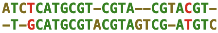
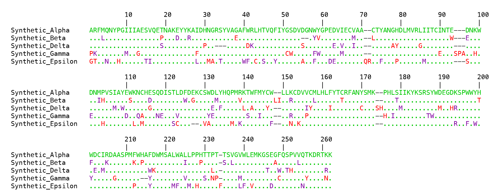

# BioTools

BioTools was developed as a lightweight collection of bioinformatics utilities for common sequence-analysis tasks, with an emphasis on convenient command-line use. It provides tools for working with DNA and protein sequences, including sequence manipulation, peptide properties, motif searching, pairwise alignment, and multiple sequence alignment.

BioTools is currently under active development.

## Features

### General sequence tools

- Search for sequences and report their positions
- Returns the length of a sequence

### DNA sequences

- Transcribe DNA to RNA
- Translate DNA in three reading frames
- Generate reverse complements
- Calculate GC content
- Pairwise DNA sequence alignment

### Protein sequences

- Calculate net charge
- Calculate molecular weight
- Calculate extinction coefficient
- Search for and highlight N-linked glycosylation sites
- Compare two sequences and look for conserved motifs of varying lengths
- Pairwise protein sequence alignment
- Multiple sequence alignment from FASTA files
- Generate publication-quality PNG and TIFF alignment images
- Display alignment differences relative to a reference sequence

## Installation/Requirements

BioTools is currently under development and is not yet available on PyPI.

BioTools requires Python 3.15 or later. Installation from source also requires a Rust toolchain (the Rust compiler and Cargo build system), which can be installed from https://rustup.rs, and uv.

To verify that Rust is installed, run 

```bash
rustc --version
cargo --version
```

Rust is only required during installation to compile the extension; it is not required to run BioTools afterward.

Installing uv:

BioTools uses uv, a Python package and project manager, for installation.
If you don't already have uv installed, follow the official installation instructions at 

https://docs.astral.sh/uv/getting-started/installation/

On macOS and Linux, you can install it with:

```bash
curl -LsSf https://astral.sh/uv/install.sh | sh
```

Verify the installion:

```bash
uv --version
```

Install python 3.15:

```bash
uv python install 3.15
```

Clone the repository:
```bash
git clone <repository-url>
cd biotools
```

Finally, install BioTools using uv:

```bash
uv tool install .
```

After installation:
```bash
biotools -h
```

## Usage

BioTools provides a command-line interface:
```bash
biotools <command> [options]
```

For a list of available commands:
```bash
biotools -h
```

For help with an individual command:
```bash
biotools msa -h
```

### Rebuilding the Rust extension

After modifying Rust source code, rebuild and reinstall BioTools
from the repository root:

    uv tool install --reinstall -e .

This recompiles the Rust extension and updates the globally
installed `biotools` command.

### Examples

#### Translate DNA in all three forward reading frames.

```console
$ biotools translate acttactggtcgtagtca
Frame 1: TYWS*S
Frame 2: LTGRS
Frame 3: LLVVV
```

#### GC Content

```console
$ biotools gc atgacggtagctagtagctacgtatcattcatctatccgcgcgtagtagtacgt
Total bases: 54
A: 13
C: 12
G: 13
T: 16
AT Content: 53.70
GC Content: 46.30
```

#### Display protein charge, molecular weight, and extinction coefficient together with props, or calculate each individually.
```console
$ biotools props adlsykfehyaskgascwedasdkflsdad
Charge = -4
Molecular Weight = 3357.6
Extinction Coefficient = 8370 
```

#### Pairwise Alignment of DNA or Protein
```console
$ biotools dna_align atctcatgcgtcgtacgtacgt tgcatgcgtacgtagtcgatgtc
```


#### Multiple Protein Sequence Alignment
BioTools implements a custom progressive multiple protein sequence alignment algorithm using a guide tree and BLOSUM62-based pairwise scoring. Expensive calculations are performed using a rust extension.


```console
$ biotools msa example.fasta --save alignment.png --diff --wrap 100
```


Conservative substitutions are shown in purple, non-conservative substitutions in red, and gaps as black dashes. When `--diff` is enabled, identities to the reference sequence are shown as dots.


## Development status

BioTools is currently in development. Interfaces and command-line options
may change before version 1.0. Known limitations include:

- Multiple sequence alignment currently uses linear rather than affine gap penalties.
- Multiple sequence alignment current supports proteins only.
- DNA alignments do not currently support image output.
- Printing Cluster trees is VERY rough at the moment. 

## License

BioTools is licensed under the BSD 3-Clause License.